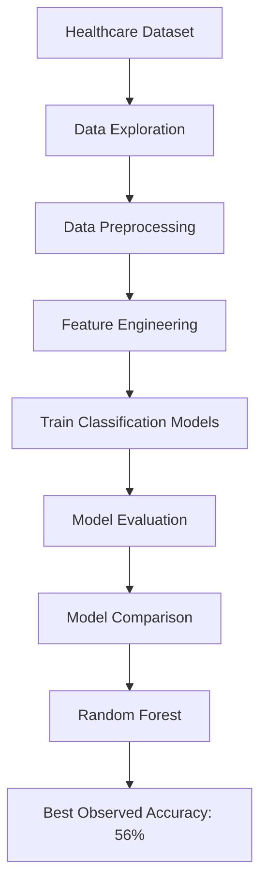

# ❤️ Heart Attack Risk Prediction Using Machine Learning

  
  
  
  

  <b>Applying Machine Learning to Healthcare Risk Prediction</b>
   
  Exploring demographic, lifestyle, and clinical factors to classify potential heart attack risk.

---

## 📌 Project Overview

Can machine learning help identify patterns associated with heart attack risk?

This project explores the application of machine learning classification algorithms to healthcare data containing demographic, lifestyle, and clinical attributes.

The objective was to preprocess healthcare data, perform exploratory data analysis, train multiple classification models, and identify the model with the best performance among those evaluated.

<b>🎯 Project Highlights</b>

- Implemented three classification algorithms.
- Built a data preprocessing pipeline.
- Performed exploratory data analysis and visualization.
- Compared Logistic Regression, Decision Tree, and Random Forest.
- Achieved the highest observed accuracy of **56% using Random Forest**.

## 🧭 Table of Contents

- [Problem Statement](#-problem-statement)
- [Dataset and Features](#-dataset-and-features)
- [Technology Stack](#-technology-stack)
- [Machine Learning Workflow](#-machine-learning-workflow)
- [Models Implemented](#-models-implemented)
- [Results](#-results-and-evaluation)
- [Key Learnings](#-key-learnings)
- [Limitations](#-limitations)
- [Future Improvements](#-future-improvements)
- [Disclaimer](#-disclaimer)

---

## 🔍 Problem Statement

Heart disease is an important healthcare challenge. Identifying patterns in demographic, lifestyle, and clinical data can help researchers explore factors associated with cardiovascular risk.

The objective of this case study was to:

1. Prepare structured healthcare data for machine learning.
2. Explore relationships between input features and the target variable.
3. Train multiple classification algorithms.
4. Compare model performance.
5. Identify the best-performing model among the tested approaches.

## 📊 Dataset and Features

The dataset contains demographic, lifestyle, and clinical attributes.

| Category | Features |
|---|---|
| Demographic | Age, Sex |
| Clinical | Cholesterol, Blood Pressure, Heart Rate |
| Lifestyle | Lifestyle habits, Smoking Status |
| Other reported indicators | Hypertension, ECG Results |

### Data preprocessing

The preprocessing workflow included:

- Handling missing values.
- Encoding categorical variables.
- Feature scaling.
- Feature engineering.
- Balancing class distribution.

## 🛠️ Technology Stack

| Technology | Purpose |
|---|---|
| Python | Programming language |
| Pandas | Data manipulation |
| Scikit-learn | Machine learning algorithms |
| Matplotlib | Data visualization |
| Seaborn | Exploratory data analysis |

  
  
  
  
  

## ⚙️ Machine Learning Workflow

The project follows a structured machine learning pipeline.

### Workflow breakdown

<b>1. Data Exploration</b>

- Examined the dataset structure.
- Explored demographic and clinical attributes.
- Used statistical analysis and visualizations to understand the data.

<b>2. Data Preprocessing</b>

- Handled missing values.
- Encoded categorical variables.
- Applied feature scaling.
- Performed feature engineering.
- Addressed class distribution imbalance.

<b>3. Model Training</b>

Trained three supervised classification algorithms using Scikit-learn:

- Logistic Regression
- Decision Tree
- Random Forest

<b>4. Model Evaluation</b>

Compared the trained models to identify the best-performing classifier based on the evaluation performed in this study.

## 🤖 Models Implemented

| Algorithm | Approach |
|---|---|
| Logistic Regression | Linear classification |
| Decision Tree | Tree-based classification |
| Random Forest | Ensemble learning |

## 📈 Results and Evaluation

  
  

Among the three evaluated algorithms, Random Forest achieved the highest observed accuracy.

| Model | Result |
|---|---|
| Logistic Regression | Evaluated |
| Decision Tree | Evaluated |
| **Random Forest** | **56% accuracy — highest among tested models** |

**What does this result tell us?**

The result demonstrates that model performance can be challenging when working with healthcare datasets. Accuracy alone is not sufficient to establish whether a model is suitable for medical risk prediction.

Further evaluation is necessary to understand the model's classification performance.

## 💡 Key Learnings

Through this project, I gained practical experience in:

- Preparing structured healthcare datasets.
- Handling missing values and categorical variables.
- Performing exploratory data analysis.
- Implementing supervised machine learning algorithms.
- Comparing classification models.
- Interpreting model evaluation results.
- Understanding the challenges of applying ML to healthcare problems.

## ⚠️ Limitations

- The best observed model accuracy was 56%.
- Further evaluation is needed to understand false positives and false negatives.
- The model's generalizability requires additional validation.
- The project is an academic machine learning case study, not a clinically validated prediction system.

## 🚀 Future Improvements

Potential improvements include:

- Hyperparameter optimization.
- Cross-validation for more reliable performance estimates.
- Evaluating precision, recall, F1-score, ROC-AUC and confusion matrices.
- Feature importance and explainability using SHAP.
- Testing on additional datasets.
- Improving model generalization.

## ⚕️ Disclaimer

This project is developed for educational and research purposes only.

It is not a medical diagnostic tool and must not be used to make healthcare decisions. The model has not been clinically validated.

---

## 👨‍💻 About the Developer

**Rithik V**  
Integrated M.Sc. Computer Science | AI & ML

Interested in building practical AI/ML solutions using Python, machine learning, generative AI, and data analytics.

  
  

  <i>Learning, experimenting, and building with AI.</i>

